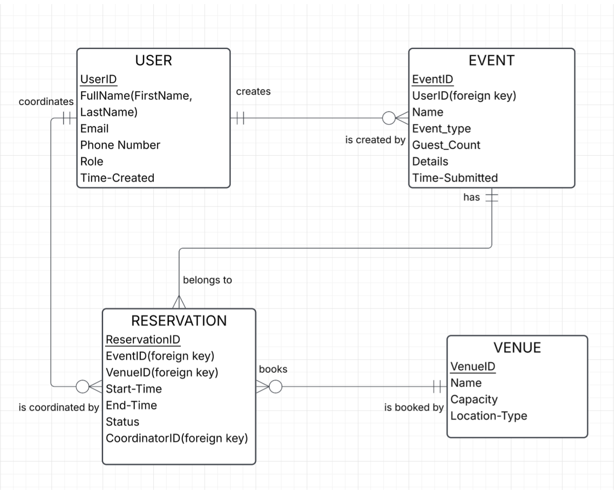
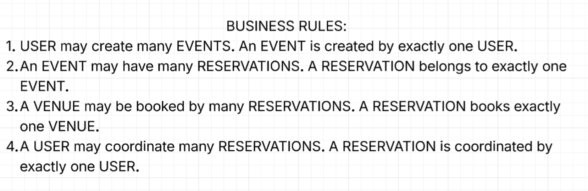

# EventBook
# EventBook

EventBook is a straightforward reservation and scheduling web platform designed for hospitality venues and event spaces. It allows clients to browse availability and book event spaces, while providing venue managers with a centralized calendar to oversee reservations.

## Core Features

* **User Accounts & Roles:** Separate access for clients (to submit and review bookings) and venue coordinators (to review, approve, or cancel reservations).
* **Space & Date Reservation:** Clients select specific venue spaces (banquet halls, meeting rooms, dining areas) and reserve them for set dates and time blocks.
* **Availability & Conflict Prevention:** Real-time scheduling logic prevents double-booking venue spaces across overlapping dates.
* **Internal Event Overview:** A centralized calendar view for management and staff to track booked dates, resource allocation, and logistical details.

## Entity-Relationship Diagram (ERD)

## Business Rules

## Database Implementation

* **The relational database system I used:** MariaDB.
* **The tables i implemented:** USER, EVENT, VENUE and RESERVATION.
* **Brief explanation of how my tables interact:** A CLIENT(USER) creates an overarching EVENT, which can contain multiple individual VENUEs or time bookings, though each EVENT belongs to only one CLIENT(USER). Each RESERVATION books exactly one VENUE for a scheduled time slot, while that VENUE can host many different RESERVATIONs over time. Finally, an assigned STAFF_COORDINATOR(USER) can oversee several RESERVATIONs, but each RESERVATION is assigned to at most one COORDINATOR(USER).

  
